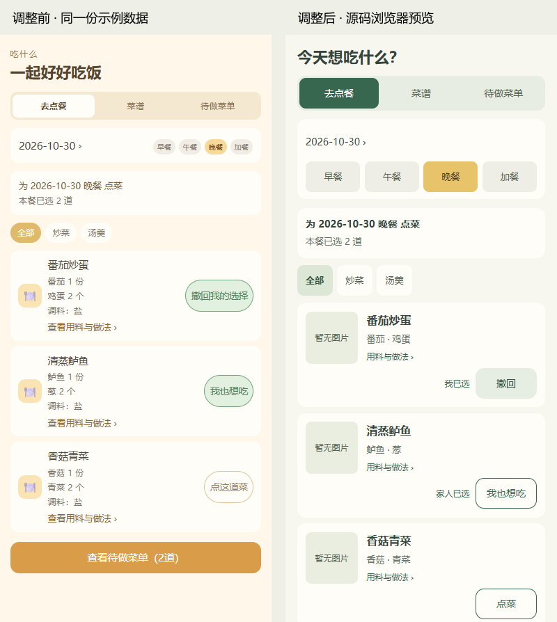

# 2026-10-30 界面与交互优化交付

## 范围与依据

用户确认整体视觉方向，要求修正“已选／点这道菜”的按钮比例，并一并处理前一轮问题表。基于已交付 0.1.4 的源码继续修改，沿用 uni-app、Vue 3、TypeScript、原生小程序组件及现有权限和接口。使用 ui-ux-pro-max、frontend-design、impeccable 完成规范检查、布局优化及复核。

本次为客户端源码候选；包版本仍为 0.1.4，尚未作为新体验版上传。0.1.4 业务提交为 16a19cf，发布元信息为 d40f561，回执为 5e8d921，所在分支为 `fix/closure-0.1.3-20261022`。main 的旧状态不能代表该分支未提交。

2026-10-30 实时读取 GitHub 远端：本轮提交前，候选分支为 `5e8d92184e44a737e0eb7768dd4291dca411af86`，main 为 `05859fdecf10f47657edf5bb4e80f93c7f3958cf`；0.1.4相关提交已在候选分支。本次UI修改继续提交至该分支，不改变main的合并状态。

## 统一设计方向

- 延续温暖、清新的家庭风格：奶白底色、深绿操作、柔和黄色餐次选择；不增加装饰动画。
- 标题约 22px，正文 14–16px，辅助文字 12–13px；原生中文系统字体，长标题允许换行。
- 点菜、我也想吃、撤回统一 **88×44px，14px 字号**，同一位置、同一宽高；“我已选／家人已选”独立显示，保留二者不同业务含义。
- 页面公共样式归入 `apps/client/src/styles/page-foundation.css`，原有页面结构继续保留。主按钮、字段标签、错误提示、禁用态、卡片间距和点击高度统一。
- 家庭管理入口与五个底部标签使用同一套本地线条图标。源矢量保存在生成脚本中，无在线图片依赖。

## 问题表逐项处理

| 编号 | 页面／问题 | 修改结果 | 验证与边界 |
|---|---|---|---|
| UI01 | 全局字号、对比度不统一 | 深绿主操作、深色正文，辅助文字提高可读性，固定最小文字尺寸 | CSS复核；同尺寸浏览器截图；未替代手机系统大字验收 |
| UI02 | 日历箭头、餐次、行李勾选点击区域小 | 主要控制目标至少44px高，箭头和勾选44×44px | 编译样式及源码浏览器度量；地图原生区域未模拟 |
| UI03 | 待办、收藏、档案加载失败与空数据混淆 | 加载文案、持久错误和显式重试；错误期间不展示“空列表” | 新增读取失败、成功重试、离开后旧失败不回填测试；档案错误渲染测试 |
| UI04 | 一张照片签名失败导致整组相册消失 | 非鉴权失败保留其他照片，失败项显示重试；401/403仍清空并通知上层 | 部分失败、重试恢复、列表失败与撤权行为测试 |
| UI05 | 成员编辑位置远、对象不明确 | 显示“正在编辑：成员名”，进入编辑后定位到编辑卡片 | 源码与成员编辑前后图；原权限回归通过；原生滚动待真机确认 |
| UI06 | 菜谱校验仅有Toast，难找到缺项 | 保留提交时校验；错误显示在名称、分类、食材、调料或步骤对应区域，并定位 | 名称／食材错误位置、无写入、保留原草稿测试；原草稿恢复与图片流程继续回归 |
| UI07 | 点餐卡片用料冗长、按钮比例失衡 | 用料摘要最多三项，完整内容从原详情打开；信息在上、状态和按钮在下 | 添加、撤回、家人已选、权限与刷新失败回归；按钮实测均88×44px |
| UI08 | 菜谱库信息与编辑发布挤在同一行 | 信息区和操作行分开，长菜名换行，操作允许折行 | 原分类ID筛选、分类编辑、发布／下架权限测试保留 |
| UI09 | 购物／库存完整表单挤占首屏 | 默认展示清单；点击添加展开；收起不丢当前输入；保存成功收起；库存编辑自动展开定位 | 真实渲染按钮路径、展开收起草稿保留、精确提交值回归 |
| UI10 | 行程推进藏在协作折叠区 | 原有推进动作移至行程标题下，保持原负责人条件和状态流转 | 折叠区关闭时可见、普通成员不可见测试；原状态／权限处理保留 |
| UI11 | 待办、收藏、档案字段只有占位提示 | 补持续可见的字段标签和日期名称 | 模板编译、输入行为回归及档案／菜谱编辑截图 |
| UI12 | 页面展示工程规则、英文权限及UTC | 精简页面说明；成员状态、最终权限中文化；邀请日期显示北京时间 | 模板审查、原保存与鉴权测试；保留必要的授权说明 |
| UI13 | 档案权限靠反复点按循环切换 | 改成“不授权／可查看／可编辑”选择器，取消不改变选择 | 选择值、无效值、忙碌态和原授权载荷精确断言 |
| UI14 | 操作按钮反馈不统一 | 统一按钮、禁用、按下、加载和错误视觉；库存保存使用原busy锁并显示loading | 原单飞、防重复、权限失效、版本冲突测试保留；浏览器含禁用状态截图 |
| UI15 | 长中文、弹层、窄屏、键盘适配 | 长标题换行，窄屏表单折行；弹层保留可滚动内容；输入设置原生cursor-spacing=100 | 320／390／430宽预览无页面水平溢出；微信胶囊、原生键盘、底部安全区及大字模式仍待手机验证 |
| UI16 | 图标风格依赖系统Emoji | 主要设置入口与底部标签改成本地统一线条图标 | PNG可读取且小程序独立构建包含所有图标；原生tabBar外观待手机确认 |

## 自动化验证（2026-10-30）

全部在本机源码和隔离编译产物上执行：

| 检查 | 结果 |
|---|---|
| 客户端完整 Node 行为测试 | **499/499**，原491项保留，增加8项针对本轮交互／异常的回归 |
| vue-tsc | 通过 |
| ESLint | 通过，0 warning |
| uni-app 微信小程序独立目录构建 | 通过 |
| 编译后JS/WXML交互 | **3/3**：菜谱输入与保存、模板创建返回套用、目的地与日期保存 |
| 当前API DTO合同检查 | **3/3**，真实ValidationPipe；鉴权、服务及持久化为模拟 |
| impeccable静态扫描 | 返回 `[]`，退出码0；只作静态辅助证据 |
| 浏览器源码预览 | 18种页面／状态 × 前后 × 3宽度 = **108张**；修改后54张无页面水平溢出 |
| 接口与数据变更检查 | services、API、worker及packages无差异；未增加数据库迁移 |
| Git diff whitespace | 通过 |

独立构建目录记录在本机 `.codex-tmp/ui-review-20261029/build-final-path.txt`。构建目录不进Git；它是候选验证产物，并非平台已上传版本。

### 前后截图

这些图片来自**真实Vue模板和CSS在浏览器中的源码预览**，使用固定虚构数据；不是微信开发者工具或手机截图。每对尺寸、数据及初始状态相同。由于没有菜品照片夹具，点餐卡片展示“暂无图片”状态，不使用真实家庭照片。



| 场景 | 修改前 | 修改后 |
|---|---|---|
| 长菜名，320×844 | [前](ui-polish-20261030/meal-long-before-320.png) | [后](ui-polish-20261030/meal-long-after-320.png) |
| 菜谱详情，320×844 | [前](ui-polish-20261030/meal-detail-before-320.png) | [后](ui-polish-20261030/meal-detail-after-320.png) |
| 购物清单，390×844 | [前](ui-polish-20261030/shopping-list-before-390.png) | [后](ui-polish-20261030/shopping-list-after-390.png) |
| 库存登记，390×844 | [前](ui-polish-20261030/shopping-stock-form-before-390.png) | [后](ui-polish-20261030/shopping-stock-form-after-390.png) |
| 菜谱编辑，390×844 | [前](ui-polish-20261030/recipe-editor-form-before-390.png) | [后](ui-polish-20261030/recipe-editor-form-after-390.png) |
| 日历，390×844 | [前](ui-polish-20261030/index-calendar-before-390.png) | [后](ui-polish-20261030/index-calendar-after-390.png) |
| 我的家，390×844 | [前](ui-polish-20261030/profile-home-before-390.png) | [后](ui-polish-20261030/profile-home-after-390.png) |
| 行程详情，390×844 | [前](ui-polish-20261030/camping-detail-before-390.png) | [后](ui-polish-20261030/camping-detail-after-390.png) |
| 成员编辑，390×844 | [前](ui-polish-20261030/members-editor-before-390.png) | [后](ui-polish-20261030/members-editor-after-390.png) |
| 档案授权，390×844 | [前](ui-polish-20261030/archive-grants-before-390.png) | [后](ui-polish-20261030/archive-grants-after-390.png) |

[108张预览的布局度量](ui-polish-20261030/metrics.json)。其余状态图可按下方命令复现。截图不绘制假的微信顶栏／胶囊／tabBar；浏览器不能真实实现picker、switch、地图和系统键盘。行程截图内路线／相册组件使用明确标记的占位，其真实行为由独立组件回归覆盖，地图视觉和原生选择器不在这些截图验收范围。

### 复现

在仓库根目录，客户端依赖已安装，并在NODE_PATH提供playwright、sharp：

```text
node scripts/verify-ui-preview.cjs <新的输出目录>
node scripts/generate-ui-icons.cjs
```

预览默认使用本机Edge，`UI_BROWSER=chrome`可切换；默认修改前源码固定为5e8d921，避免下一次提交改变对照基线。这两个工具不访问后端，使用本地矢量与虚构夹具。

## 后续微信检查

新候选上传后，手机需重点核对：

1. 点餐、我也想吃、撤回三个动作，操作后菜单与数量同步。
2. 菜谱跨相册返回、关闭后恢复草稿；保存校验定位及键盘遮挡。
3. 购物／库存展开收起、填写和保存；名称、数量、单位、位置保持正确。
4. 档案选择器取消／确认的授权结果，成员编辑定位。
5. 行李勾选、模板套用、负责人及准备组选择，部分图片失败后的重试。
6. 原生顶栏胶囊、底部标签和安全区、窄屏及微信大字模式。

上述手机验证未执行。既有Q01地图阶段线型未在本轮解决，不能因为本轮视觉优化就将该历史事项关闭。
